# Metroll

A spiked steel ball, the head of a morning star with no morning star
attached, is rolling through fifty years of metal. Twelve tracks, from
Birmingham in 1970 to a muddy field in Germany in 2008, and on every one of
them it runs into the annoying people in the way (posers, gatekeepers, hair
metal guys, scene kids, a coroner, a troll who wants a toll) fast enough to
smash them, and says something unkind about it afterwards. Every track is a
place and a year and a genre: heavy metal, hair metal, thrash, goth,
hardcore, death metal, black metal, doom, industrial, nu metal, screamo and
the festival where all of them are in the same field. Each has its own
light, its own weather, its own band and its own way of dropping things on
you on the beat.

It is sarcastic, it is smug, and it trolls: the posers, the bands, the fans,
the genres, and above all you.

A spinoff of the [Rock 'n' Roller](https://github.com/h1ddenpr0cess20/rocknroller)
games, on the engine of [Rock 'n' Roller III](https://github.com/h1ddenpr0cess20/rocknroller-iii)
(the renderer, physics, tiled venues and camera), with the tracks, cast,
props, machinery, score and voice all redone. Rock himself, the boulder from
the first game, turns up at the end as the last boss. He was here first, and
has opinions about the spikes.

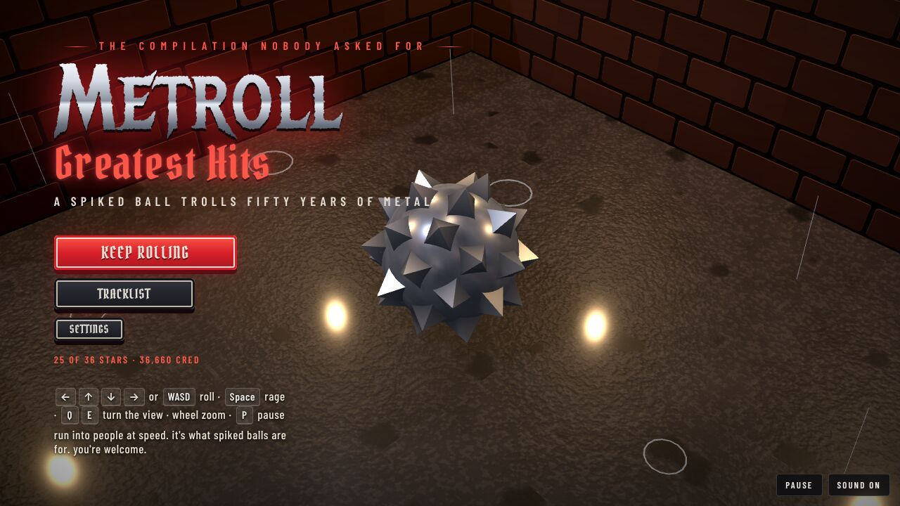

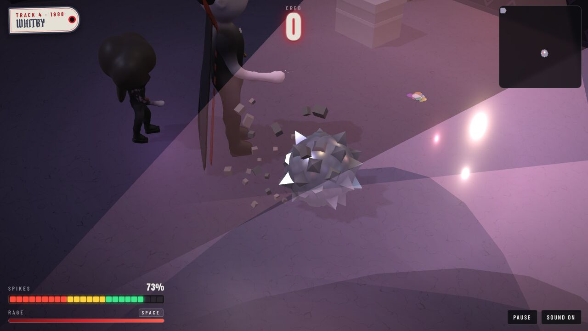

## Run

```sh
git clone https://github.com/h1ddenpr0cess20/metroll
cd metroll
npm install
npm run dev               # → http://localhost:5173
```

It is a static page: no server, no keys. `npm run build` puts it in `dist/`,
which runs from any folder or path. It uses WebGPU where the browser has it and
WebGL2 otherwise. Node 22.12 or later.

## Play

| | |
|---|---|
| <kbd>←</kbd><kbd>↑</kbd><kbd>↓</kbd><kbd>→</kbd> or <kbd>WASD</kbd> | Roll. The streets run diagonally across the screen, so hold two at once. |
| <kbd>Space</kbd> or <kbd>Shift</kbd> | **Rage**: hold to charge. Harder push and a higher top speed, until it runs dry. |
| Hold the mouse or a finger | Roll toward the pointer. The further it is from Metroll, the harder the push. On a touch screen there is a RAGE button. |
| <kbd>Q</kbd> <kbd>E</kbd>, or drag with the right mouse button | Turn the view. Dragging up and down tilts it. |
| Mouse wheel, or <kbd>+</kbd> <kbd>−</kbd> | Zoom. |
| Two fingers | Pinch to zoom, twist to turn, drag up or down to tilt. |
| <kbd>C</kbd> | Put the view back. |
| <kbd>Enter</kbd> / <kbd>Space</kbd> | Go, and carry on after a track. |
| Gamepad | Left stick or d-pad rolls; right stick turns and tilts; shoulder buttons zoom; <kbd>A</kbd>, <kbd>X</kbd> or the right trigger rages; <kbd>Start</kbd> pauses. |
| <kbd>P</kbd> / <kbd>Esc</kbd> | An intermission (pause). |
| <kbd>M</kbd> | Sound on or off. |

### Speed is everything

How hard Metroll hits someone depends on how fast it was going, in tiles a
second. Everybody has a **toughness**, the speed it takes to smash them in one
go, and a **power**, how much it hurts to bounce off them.

| Speed | | What happens |
|---|---|---|
| 1.7 times what it takes (13 at the least) | **OBLITERATED!** | Gone, with double the cred. |
| At least their toughness | **SMASHED!** | Gone, and it costs Metroll nothing. |
| Over half their toughness | **BONK** | You both bounce. It costs Metroll some of their power, less the closer you were to a smash. |
| Under that | **WEAK** | It hurts, all of their power, and they don't move. |

The furniture is fair game too: bins, tables, amps, barriers and portable
loos all go over if Metroll comes at them fast enough (the bigger, the
faster), for a little cred. Someone who isn't smashed is still worn down, and
a doorman you can't hit hard enough can be hit twice. The three bosses take a
good deal more than that.

### Staying in one piece

- **Spikes** start at 100. Knocks, live wires, things dropped on the beat, the floor bursting, falls take them away; a **whetstone** puts 25 back, and the spikes come back with it. Watch the ball: the spikes snap off as they go.
- At nothing, Metroll is blunted, unless it picked up a **lighter**: hold it up for an **encore**, and it gets back up on half.
- **Cred** is the score. Guitar **picks** are worth a little, a **record** more; smashing people is worth more than that, and smashing them one after another builds a combo (up to ×5) that multiplies each one.

### Stars

Each track gives up to three:

1. **Show up**: get to the stage door. (Low bar.)
2. **Professional troll**: smash three in four of the people in the way.
3. **Tape trader**: find all three **demo tapes**.

Your stars, best cred and best time for each track are kept in the browser's
local storage (`metroll.v1`), and each track opens when you finish the one
before. The game plays the same with storage blocked.

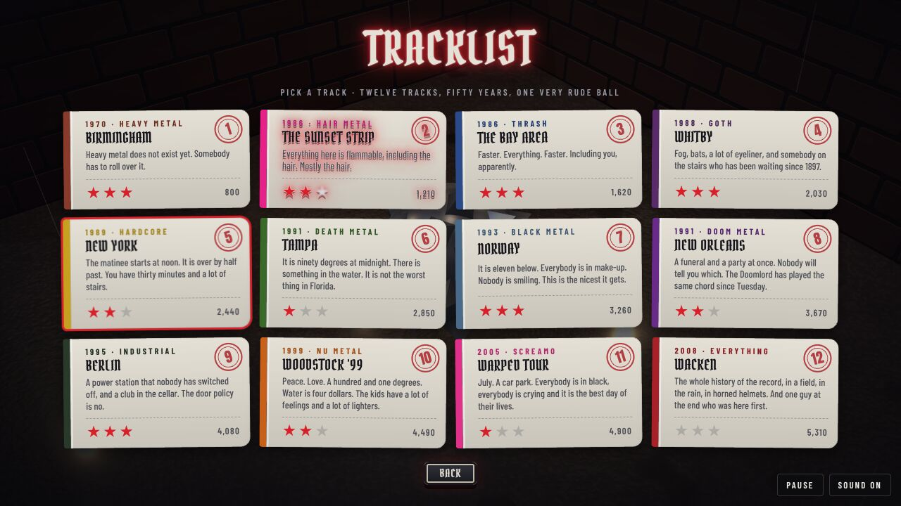

### What is in the way

- **Closed gates**: a barrier, an iron gate, a velvet rope, a toll booth across the way on. Find the **backstage pass** somewhere on the same track to lift it.
- **Breakaways**: plywood, plasterboard, a canvas flap, a snowdrift, a sheet of glass. Run at one fast enough and it gives way. Behind them are usually demo tapes.
- **Drops**, coming down on the beat, a different thing on every track: Birmingham's anvils, hairspray cans on the Strip, kick drums in the Bay Area, coffins in Whitby, dumpsters in New York, gravestones in Tampa, snowballs in Norway, a funeral bell in New Orleans, hydraulic presses in Berlin, lighting trusses at Woodstock, energy drinks at the Warped Tour, beer kegs at Wacken. Wait for the moment they go up.
- **The floor goes up** on the beat: steam off the New York streets, green gas off the Tampa swamp, frost in Norway, smoke in New Orleans, a welder's sparks in Berlin, fire at Woodstock, fireworks on the Strip, fog in Whitby.
- **Live wires** zap whatever rolls onto them; water does the same.
- **Rides**: a narrowboat, a pink limousine, a hearse, a subway car, an airboat, a longship, a skiff, a flatcar, a hay wagon, a band's van, a mud trailer, and in the Bay Area the crowd's hands. Get on while they wait.
- **Ice** in Norway, where Metroll can hardly push and hardly stop; **sticky floors** (the mud at Woodstock and Wacken) slow it; **conveyors** and **the crowd** carry it; **bumpers** (hydrants, runestones, firebarrels, candles, viking shields, palms, beach balls) throw it back.

## The tracklist

Every track is laid out its own way, lit its own way, and played in its own
music.

| | Track | The way through |
|---|---|---|
| 1 | **Birmingham, 1970** · Heavy metal | In the rain. Down a wet street of terraces, a steelworks with the anvils coming down and the furnaces going off on the beat, a canal and its narrowboat, a works gate that wants a pass, a pub with a folkie in the corner, and a stage in the back. Nobody has invented the genre yet. Somebody has to roll over it. Slow, heavy, a tritone on the riff. |
| 2 | **The Sunset Strip, 1986** · Hair metal | Pink limousines, hot tubs and motorbikes, a lot of hairspray (and the cans come down on the beat), a velvet rope, and the club, where it is all fireworks. A major-key anthem, a big gated snare, a flashy lead. |
| 3 | **The Bay Area, 1986** · Thrash | A van, a car park, a skate park, a pit with the crowd surging from one side to the other on conveyors, and kick drums off the ceiling. Faster. Faster. Flat out. |
| 4 | **Whitby, 1988** · Goth | An abbey on the cliff, a churchyard in the fog, the coffins on chains in the crypt stairs, the hearse across the harbour, a pavilion that wants a pass, and **the Count**, who has been waiting a long time for somebody to come down the stairs. A clean guitar going round, strings, a theremin. |
| 5 | **New York, 1989** · Hardcore | A Sunday matinee in a basement, the whole show over in half an hour. Off the stoop and along the avenue with the steam coming up and the dumpsters coming down, a subway car across the tracks, a door with a policy, and a cellar full of kids with X's on their hands. A d-beat. Short. No encores. |
| 6 | **Tampa, 1991** · Death metal | A car park behind a strip mall, a boardwalk over the swamp with the gators under it and the green gas coming up, a churchyard with the headstones on chains, an airboat across the bayou, a morgue with a steel door, and a recording studio where somebody is doing the vocals through a bucket. Blast beats, the lowest guitars there are. |
| 7 | **Norway, 1993** · Black metal | A car park outside a very old wooden church (it is fine; do not ask), a forest road in the snow, black ice, a mountain pass with snowballs coming down on the beat, a longship over the fjord, a toll booth with **a troll** in it who does not take cards, and a hall where nobody is smiling. Tremolo-picked, high and cold. |
| 8 | **New Orleans, 1991** · Doom | A courtyard off Bourbon Street, a second line with the brass out, a cemetery where everyone is buried above the ground, a funeral bell coming down on the beat, a skiff across the bayou, a plantation gate, and **the Doomlord**, who has been playing the same chord since Tuesday. A funeral with a riff. |
| 9 | **Berlin, 1995** · Industrial | A power station nobody has switched off: an assembly line with the presses coming down and the welders not looking up, a conveyor, a flatcar over the cooling pond, a tunnel full of drones, a queue that has been there since Thursday outside a door with a policy (the policy is no), and the club, a concrete room with a strobe in it. Four on the floor. |
| 10 | **Woodstock '99** · Nu metal | A decommissioned air base in a heat wave: the tent village, the runway with the trusses coming down and the bins on fire, the mud, a hay wagon across the trench, and the main stage field with ten thousand people breaking stuff, and a sign by the trench that says KEEP ROLLIN', which is the job description. Water is four dollars. A syncopated stutter, the bass up front. |
| 11 | **Warped Tour, 2005** · Screamo | A car park in July: the vendor midway where everybody is giving away a sticker, the energy drinks coming down, a skate park, a van across the storm drain, and a field full of kids in black, crying, having the best day of their lives. A sing-along over fast power chords, with a breakdown in it. |
| 12 | **Wacken, 2008** · Everything | The whole history of the record, in a field, in the rain, in horned helmets: the camp road with the kegs coming down, the mud, a mud trailer across the trench, the medieval village (knights, wizards, a very tall man in a horned helmet), the gate, and the main stage, where somebody has been waiting in the middle of the floor since 1971. **Rock.** |

| | |
|---|---|
| 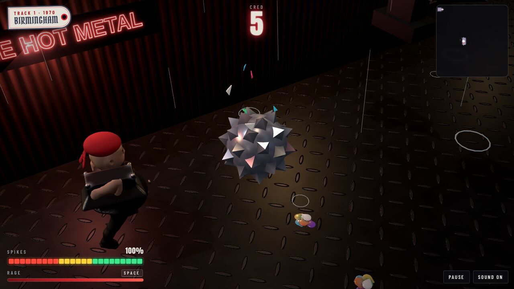 | 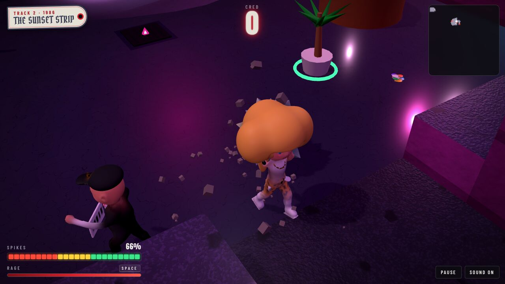 |
| 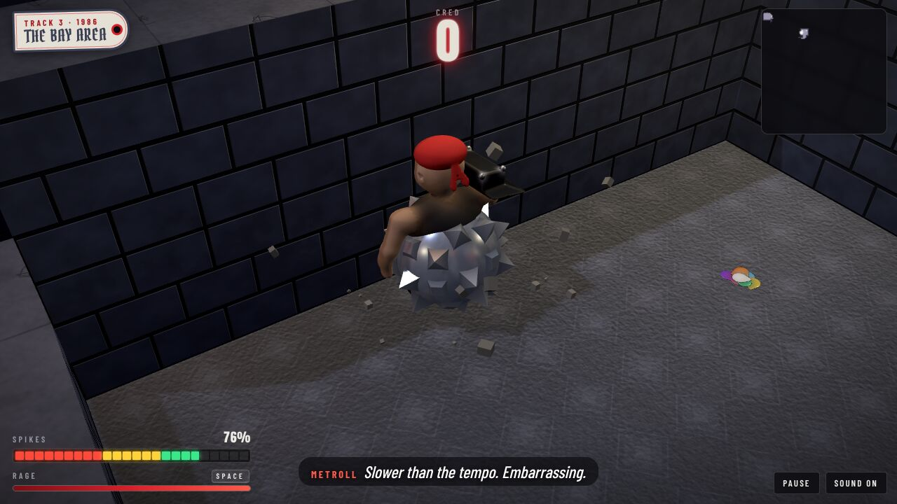 | 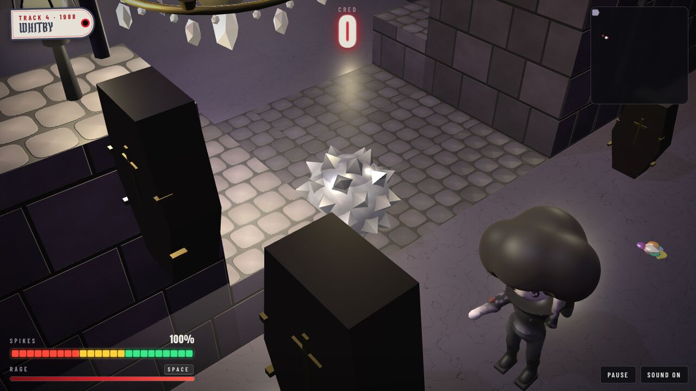 |
| 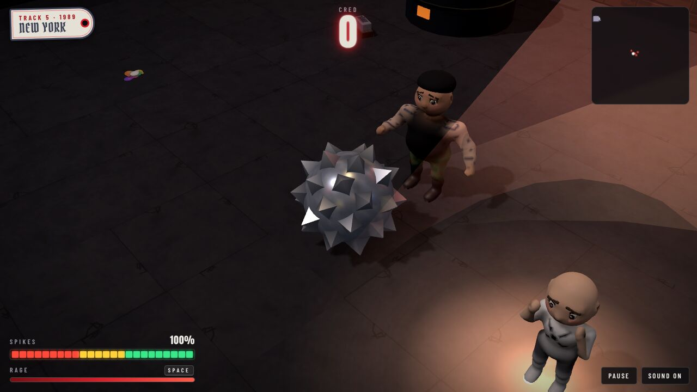 | 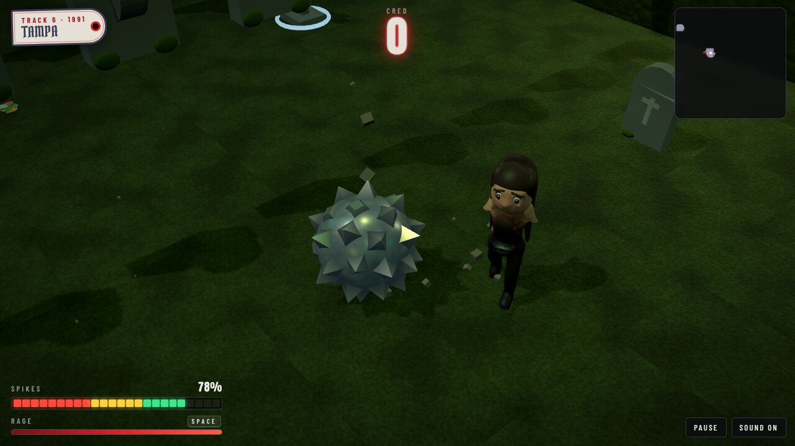 |
| 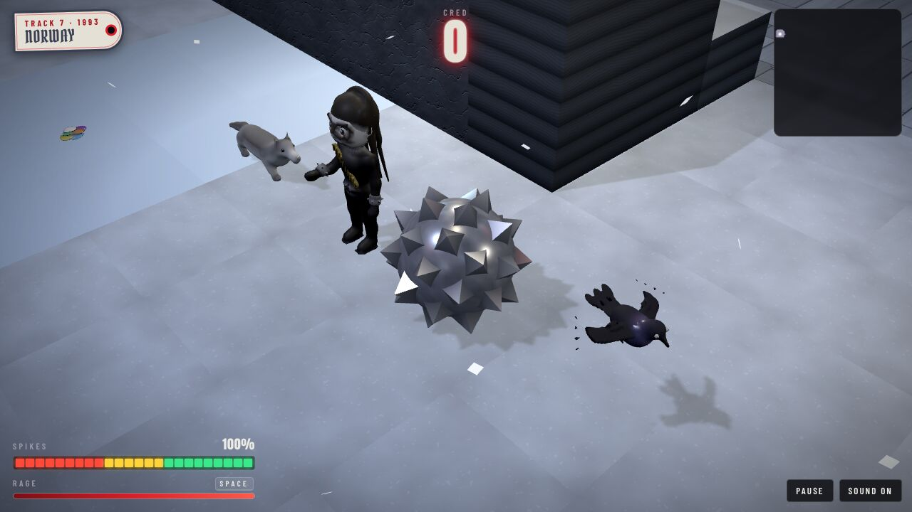 | 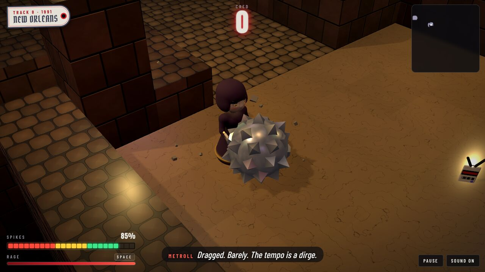 |
| 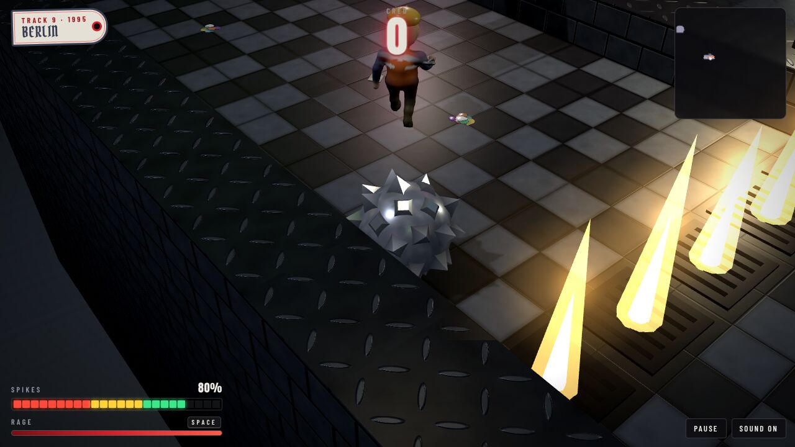 | 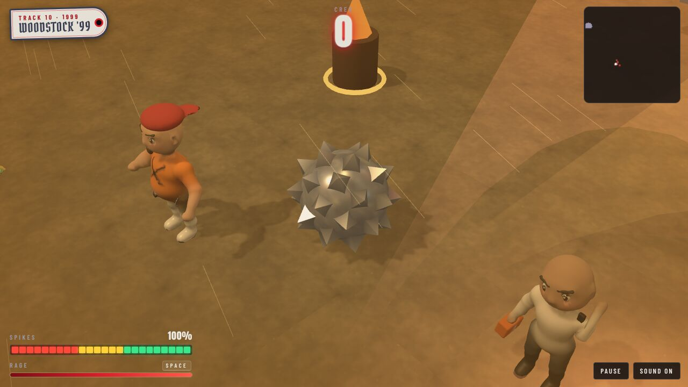 |
| 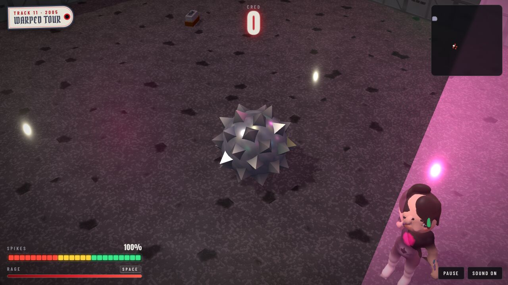 | 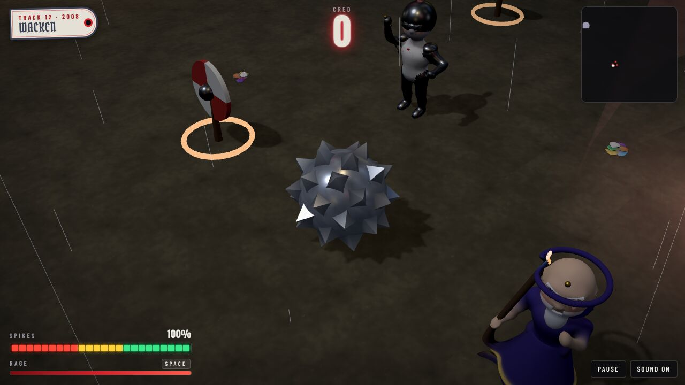 |

## The light and the weather

Each track is graded in its own light (`look.grade`): steel for Birmingham,
neon for the Strip, faded denim for the Bay, violet mist in Whitby, bare
bulbs in a basement, green dark in Tampa, the cold of Norway, the haze of the
bayou, the grey of a factory, the dust of Woodstock, a sunset over a car park,
and a storm over Wacken. Its sky is painted behind it, with a horizon (`look.horizon`)
of a steel town, the Strip, the Bay, an abbey, Manhattan, a swamp, a fjord,
a bayou, a power plant, an air base, a fairground or a festival, and the weather falls
on it: rain in Birmingham and at Wacken, snow in Norway, dust blowing at
Woodstock.

The rig (`src/lightshow.js`) keeps the beat of the music: pars, spots,
strobes, lasers, neon signs, chandeliers, festoons, searchlights and
street lamps. Strobes and lightning never flash more than three times in any
second, and **Settings → Flashing lights** turns them, and the flashbulbs,
down to a glow.

## The music

Played live in Web Audio (`src/music.js`), with no audio files: a theme for
every track, each with its own drums, bass line, rhythm part and lead, and a
tempo that goes from a funeral march (New Orleans, 64) to a blast beat
(Norway, 198). The main title is a heavy anthem with the guitars wide open.
A slow, heavy tritone riff for Birmingham; a major-key anthem with a
keyboard pad for the Strip; palm-muted, chromatic thrash for the Bay Area; a
clean guitar and a theremin for Whitby; a d-beat for New York; blast beats
and the lowest guitars there are for Tampa; tremolo-picked and cold for
Norway; a brass band's dirge with the guitars coming in underneath for New
Orleans; a four-on-the-floor machine for Berlin; a syncopated stutter for
Woodstock; a sing-along with a breakdown for the Warped Tour; and for
Wacken, all of it at once, double bass drums, a gallop, brass and a shredder
over the top. The beat clock drives the hazards and the lights.

## The cast

Sculpted in code (`src/models/cast/`) and baked in background workers while
the page loads. Seventy-odd of them, and who is in the way depends on what
year it is. A poser in a band T-shirt, a hippie, a foreman, a roadie, a
merch guy, a critic; a frontman who has used a can of hairspray, a shredder,
a promoter, a limo driver; a mosher, a skater, a tape trader and a crowd
surfer; a goth, a Dracula fan, a poet and a mourner; a straight-edge kid, a
tough guy, a zine kid and a stage diver; a headbanger, a zombie, a Florida
Man and a coroner; corpse paint, a troll and a skier; a stoner, a pallbearer,
a brass man and a cultist; a welder, an engineer, a raver and a clubber; a
nu guy, a DJ, a candle kid and a medic; a scene kid, an emo, a street team
and a screamer; a viking, a wizard, a knight, a beer guy and a purist. And
the ones who work every show: doormen, bouncers, gatekeepers, security,
sound guys, cops.

The animals share a skeleton (`quadruped.js`): a Tampa gator, a wolf out of
the Norwegian spruce, a black cat who crosses the path on purpose and a subway
rat with a slice of pizza bigger than itself; and on their own, bats, crows,
pigeons, the camera drones and the line robots.

And three bosses, each fought differently: **the Count**, who lunges and then
has to get his breath back; **the Doomlord**, who stops and stamps so the floor
throws Metroll back; and **Rock**, who moves only on the beat. Rock is the
original: the granite boulder from the first game, not drawn again but the
very same file (`src/boulder.js`, untouched), at the size of a boss, rolling
when he goes, hopping when somebody is in reach, and sitting in the middle of
the last stage as if he had been there since 1971. He has opinions about the
spikes.

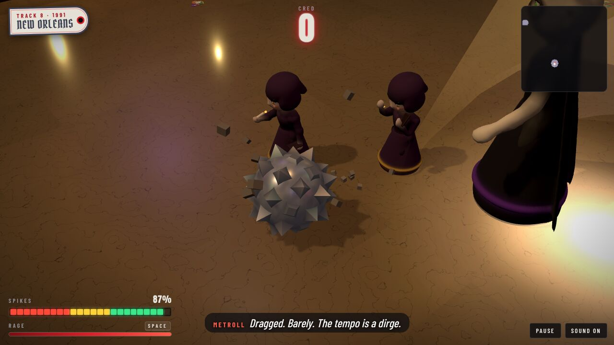

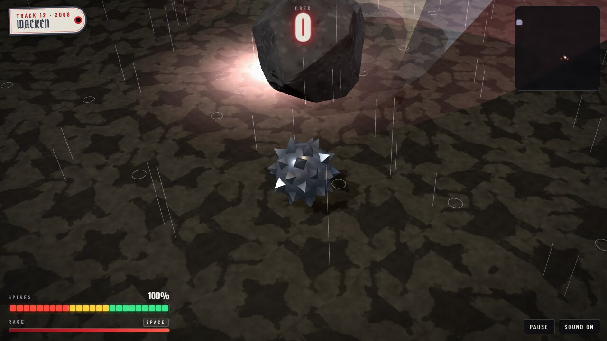

The furniture of the places is built from plain shapes in `src/sights.js`
and `src/furniture.js`: anvils and furnaces, limousines and hot tubs, a band's
van, headstones and box tombs, a boiler and a couch, a gurney and a barrel of
something green, a cypress stump, portable loos, tents and hay bales.

The page itself is a stack of gig posters and flyers photocopied too many
times: chrome and red, blackletter for the banners, hazard stripes round the
review.


## Develop

```sh
npm run dev       # the game, with hot reload
npm run build     # a static build in dist/
npm test          # node's test runner
npm run lint
```

The tests cover the rules (smashing, cred, spikes, the encore, stars,
storage), the light rig and the strobe limit, the music, the physics and
camera, and every track: each one has to be finished start to finish, with
all three demo tapes, by an autopilot (`test/helpers/autopilot.js`) that
plans a route, waits out the drops and the floor going up, takes a run-up
at the breakaways, fetches the passes and duels the bosses. Every pickup has
to be somewhere Metroll can reach and out of the hazards; every sign has to
hang on a wall the width of it; every prop has to be built, fit its
footprint and face open floor; everyone in the way has to be sculpted.

Other things in the box:

```sh
node scripts/map.js 9            # a track as text (they count from 1); --overlaps shows two pieces dug over each other
node scripts/drive.js 9          # put the autopilot through a track and say how it went
node scripts/bake.js             # bake every model and say what came out
```

`models.html` is a turntable for the cast (`?m=count,doomlord`, and
`&clip=attack&time=0&t=0.4` for a still of a moment in a clip), and in the
browser console `metroll.debug.venue(i)` jumps to a track and
`teleport(x, z)` puts Metroll somewhere on it.

## Credits

Metroll is a spiked ball. Rock is [Rock](https://github.com/h1ddenpr0cess20/rock)'s
boulder. The engine is [Rock 'n' Roller](https://github.com/h1ddenpr0cess20/rocknroller)'s,
from [dungeon-roller](https://github.com/h1ddenpr0cess20/dungeon-roller), by
way of [Rock 'n' Roller II](https://github.com/h1ddenpr0cess20/rocknroller-ii)
and [III](https://github.com/h1ddenpr0cess20/rocknroller-iii); a few of the
cast (the bat, the zombie, the robot, the drone, the crow) started life in theirs. Type is Metal Mania,
Pirata One, Anton and Barlow Condensed, from [Fontsource](https://fontsource.org).
See also [other games](docs/other-games.md).
